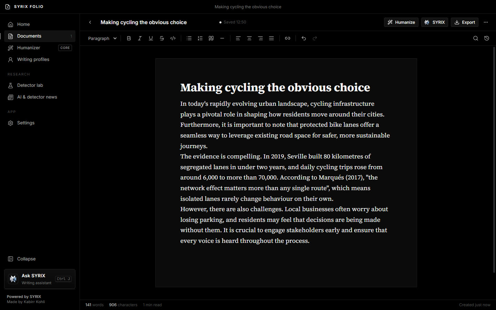
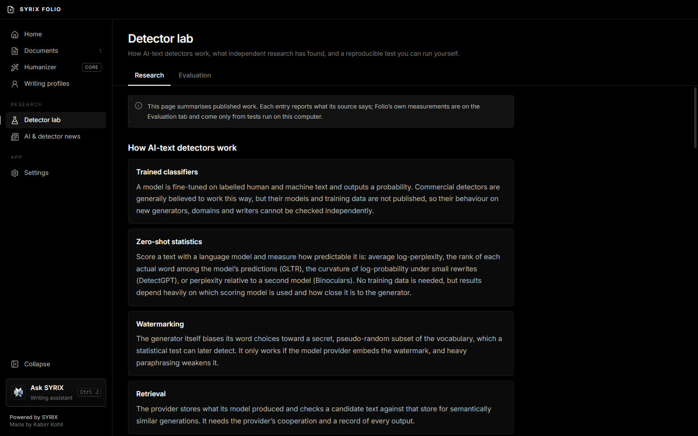
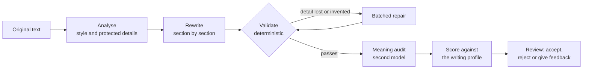

<p align="center">
  
</p>

<h1 align="center">SYRIX Folio</h1>

<p align="center">
  <b>A desktop writing studio that revises in the writer's own voice — and checks that every fact survives the rewrite.</b>
</p>

<p align="center">
  JavaScript · Electron · React · TipTap · ONNX Runtime<br>
  <a href="https://kabirr-kohli.pages.dev/syrix-folio">Project page</a> ·
  <a href="https://kabirr-kohli.pages.dev">Portfolio</a>
</p>

<br>



## Why it exists

Most AI rewriting tools make text smoother and quietly change what it says — a date moves, a name drops out, a figure is rounded. SYRIX Folio is built the other way round: the rewrite is the easy part, and the checking is the product. Every revision is compared against the original before it is shown, and anything that would change the meaning is flagged rather than accepted. It also includes a research lab that measures how AI-text detectors actually behave, including the published evidence that they misjudge non-native English writers. It is in active development.

## Highlights

| | |
|---|---|
| **Editor** | Rich text with headings, lists, tables and links, find and replace, undo history, autosave and version snapshots. Imports DOCX, PDF, HTML, Markdown, text and images (with OCR); exports DOCX, PDF, Markdown and text |
| **Revision pipeline** | Rewrites section by section to a writing profile, validates each rewrite deterministically, then has a separate model audit the meaning |
| **Writing profiles** | A measured feature vector of the writer's style, built from their own samples — "how close is this to my voice" is a measurement, not a model's opinion |
| **Assistant** | SYRIX answers questions about the open document and helps plan and improve it (Ctrl+J) |
| **Detector lab** | Published research on AI-text detection, plus a reproducible evaluation on this machine with open detectors, reporting AUROC and false-positive rates |
| **News** | Dated reporting and new research on AI writing and detection, with the source of every item |



## How a revision works



## Engineering notes

- **Protected details are checked by code, not trusted to a model.** Numbers, names, dates and quotations are extracted from the original; a rewrite that loses, alters or invents one fails validation and is repaired before the writer ever sees it.
- **Feedback becomes a number.** "More concise" or "less formal" is turned into a measurable target derived from the version being revised, stated in the prompt and checked on the result. A round that misses its target is retried with the measured figures — far more reliable than asking the model whether it succeeded.
- **The audit is not allowed to undo the edit.** A meaning auditor tends to report removed clichés ("pivotal", "fast-paced") as lost detail. Findings that quote only that kind of wording are downgraded so repairing them never puts the padding back.
- **Documents survive a crash.** Every write goes to a temporary file that is renamed over the target; the previous version is kept as a backup and restored automatically if the main file is ever unreadable.
- **Detectors that can be examined.** The lab implements published methods — perplexity, GLTR-style rank and Binoculars-style cross-perplexity — on small open models running locally, so it measures documented approaches rather than opaque services.

## Privacy and models

| | |
|---|---|
| Models | Free tiers only: Groq, OpenRouter `:free` models, or a local Ollama server |
| Local-only mode | Restricts every task to Ollama, so no text leaves the machine |
| Keys | Read from the environment or a `.env` in the app's data folder; see `.env.example` |

## Repository layout

```
src/main/       Electron main process: providers, revision pipeline, detector lab, storage, import/export
src/renderer/   React interface: editor, library, revision views, profiles, lab, settings
src/shared/     Shared code: diffing, meaning validation, prompt construction, text analysis
tests/e2e/      Playwright tests that drive the real application
scripts/        Build and benchmark scripts
```

## Running it

```
npm install
npm start
```

```
npm run test:e2e                              # end-to-end tests against the built app
set FOLIO_E2E_OFFLINE=1 && npm run test:e2e   # skip the tests that call a model
```

## Development history

Developed in a private repository — 5 commits, October 2026 — and published here as a curated snapshot. The working history stays private because it contains local configuration from development.

---

<p align="center"><sub>© 2026 Kabirr Kohli. All rights reserved. Published for viewing; no licence is granted to copy, modify or redistribute.</sub></p>
